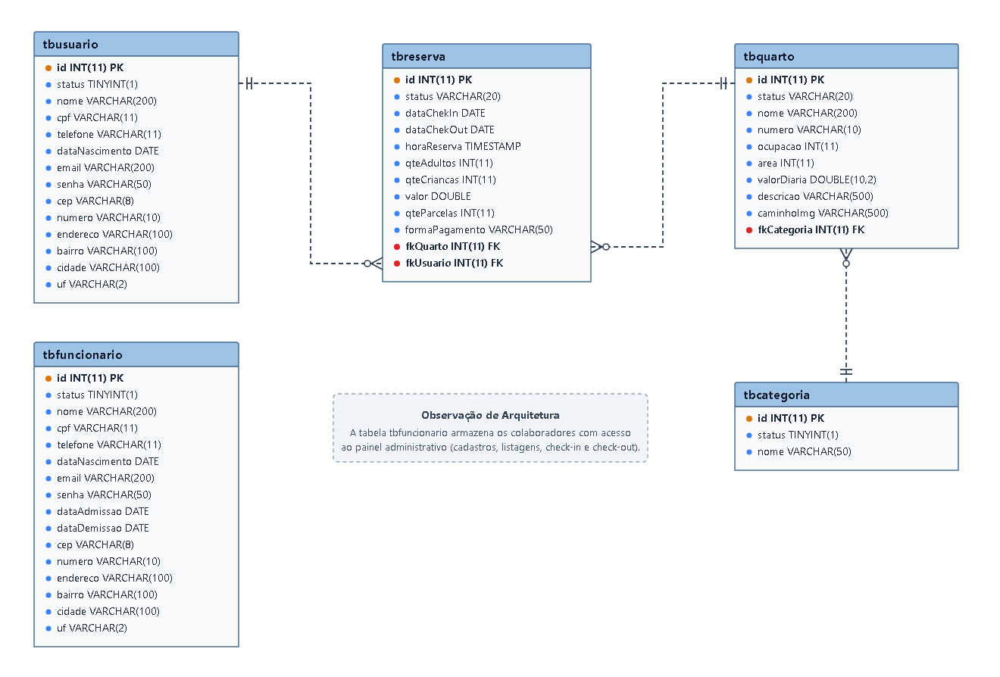

# Hotel Jardim Secreto — Sistema de Reservas e Gestão Hoteleira

Sistema web desenvolvido como **Trabalho de Conclusão de Curso (TCC)** do Curso Técnico em Informática no **IFPR Campus Umuarama**. A aplicação permite que hóspedes consultem acomodações, verifiquem disponibilidade por data e realizem reservas online, além de oferecer um painel administrativo completo para funcionários gerenciarem quartos, categorias, clientes, equipe e check-in/check-out.

## Funcionalidades

### Área do Hóspede
- **Página inicial e ambientes:** Apresentação do hotel com carrossel interativo das áreas comuns.
- **Catálogo de acomodações:** Listagem de quartos ativos com filtro por categoria e quantidade de hóspedes, além de página de detalhes individuais.
- **Busca e reserva por período:** Verificação automática de disponibilidade conforme datas de check-in/check-out, categoria e número de ocupantes.
- **Pagamento simulado:** Escolha entre Cartão de Crédito (até 12x), Cartão de Débito ou PIX (com 5% de desconto aplicado automaticamente).
- **Painel do cliente:** Acompanhamento de reservas, visualização de detalhes, cancelamento de reservas com status *reservado* e edição de perfil/senha.

### Área Administrativa (Funcionários)
- **Dashboard em tempo real:** Check-ins e check-outs previstos para o dia atual e gráfico de ocupação geral e por categoria.
- **Gestão completa (CRUD):** Cadastro, listagem com filtros, visualização, edição e inativação de:
  - Quartos (com upload de foto)
  - Categorias
  - Usuários (hóspedes)
  - Funcionários
  - Reservas (alteração de status, filtro por cliente, categoria, data e status)
- **Validações e máscaras:** Validação de CPF, telefone/DDD, e-mail, datas e preenchimento automático de endereço via API **ViaCEP**.

## Tecnologias Utilizadas

- **Back-end:** PHP 8+ (mysqli com *prepared statements* e controle de sessão por perfil)
- **Banco de Dados:** MySQL / MariaDB
- **Front-end:** HTML5, CSS3, JavaScript (Fetch API + ViaCEP)
- **Ícones:** Bootstrap Icons e Font Awesome
- **Ambiente local:** XAMPP (Apache + MySQL)

## Estrutura do Projeto

```text
JardimSecreto-Final/
├── css/                  # Folhas de estilo por página e variáveis globais
├── database/
│   └── bdjardimsecreto.sql  # Script de criação do banco e dados fictícios de exemplo
├── docs/
│   ├── diagrama-geral.png            # Diagrama geral do sistema
│   ├── diagrama-casos-de-uso.png     # Diagrama de casos de uso (UML)
│   ├── diagrama-classes.png          # Diagrama de classes (UML)
│   ├── diagrama-relacional.png       # Modelo relacional do banco de dados
│   ├── Doc Requisitos - Jardim Secreto.pdf   # Documentação de requisitos (visualização online)
│   └── Doc Requisitos - Jardim Secreto.docx  # Documentação de requisitos (editável)
├── fonts/                # Fontes locais
├── img/                  # Imagens institucionais e ícones
├── include/              # Conexão, validações, cabeçalho, rodapé e controle de sessão
├── js/                   # Máscaras, validações, carrossel e interações
├── uploads/              # Fotos dos quartos cadastrados
└── *.php                 # Páginas públicas, área do cliente e painel administrativo
```

## Modelo do Banco de Dados



## Como Executar Localmente (XAMPP)

1. Copie a pasta do projeto para o diretório `htdocs` do XAMPP (ex.: `C:\xampp\htdocs\JardimSecreto`).
2. Abra o **XAMPP Control Panel** e inicie os serviços **Apache** e **MySQL**.
3. Acesse o **phpMyAdmin** em `http://localhost/phpmyadmin`.
4. Importe o arquivo `database/bdjardimsecreto.sql` (ele já cria o banco `bdjardimsecreto`, as tabelas e os registros de exemplo).
5. Caso seu MySQL utilize usuário/senha diferentes do padrão do XAMPP (`root` sem senha), ajuste o arquivo `include/conexao.php`.
6. Acesse no navegador: `http://localhost/JardimSecreto/`.

### Contas de Exemplo (dados fictícios)
* **Funcionário (Admin):** `admin@jardimsecreto.com` | Senha: `12345678`
* **Cliente (Hóspede):** `cliente@jardimsecreto.com` | Senha: `12345678`
